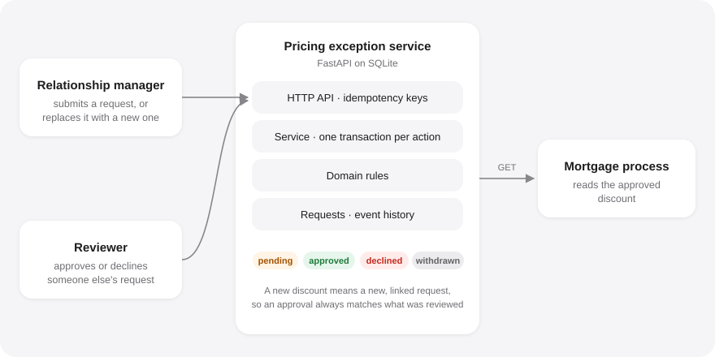

# Pricing exception service

A small internal service where relationship managers ask for a discount on
a mortgage rate. Reviewers approve or decline it. The mortgage
application process reads the approved discount.



## Start

```bash
make install   # creates .venv and installs dependencies
make run       # starts the API and UI on http://localhost:8000
make demo      # in a second terminal: a full scenario against the service
make check     # lint, types, tests and the invariant check
```

Open <http://localhost:8000> and use **Signed in as** picker to switch users. The database starts with example requests in every state.
Interactive API docs are at <http://localhost:8000/docs>.

## What it does

| Who | Can do |
|---|---|
| Relationship manager | Submit a request, then change or withdraw it while pending |
| Reviewer | Approve or decline someone else's pending request |
| Mortgage process | Read the approved discount of an application (the only role that can) |
| Everyone | See any request with its full history |

Example users: `arthur` and `ford` are relationship managers, `tricia` and
`fenchurch` are reviewers. `cindy` has both roles (shows nobody can
approve their own request). `mortgage-engine` stands for the downstream
system.

## The key decision

"One stakeholder wants managers to change a discount after submitting.
Another wants every approval to apply to exactly what was reviewed."

Both are possible if a request never changes once submitted. Changing the
discount **withdraws** the current request and creates a new one that links
back to it. This way, the reviewer always decides on a fixed version, but the
manager can still change their mind. The history shows every version.
See [D1 in decisions](docs/decisions.md#d1-submitted-requests-never-change).

## Assumptions

- Applications and users already exist elsewhere. They are seeded here.
- Authentication I left out of scope. The `X-User-Id` header says who is
  calling, and roles come from the seeded users.
- Discounts are whole basis points between 1 and 100 (configurable), and
  must stay below the standard rate.
- An application has at most one pending or approved request at a time.
- A decision is final. Declining needs a note.

## Deliberately left out of scope

- Real authentication and authorisation.
- Limiting a relationship manager to their own applications.
- Revoking an approval or expiring it after a period.
- Pagination on list endpoints.
- Notifications to reviewers.

## Documentation

| Document | Description |
|---|---|
| [requirements.md](docs/requirements.md) | User stories, each criterion linked to the test that proves it |
| [user-guide.md](docs/user-guide.md) | How RMs and reviewers use the screen |
| [architecture.md](docs/architecture.md) | Layers, data model, retries and error handling, with diagrams |
| [decisions.md](docs/decisions.md) | Why things are the way they are |
| [invariants.md](docs/invariants.md) | Rules that must never break, each with its test |
| [operations.md](docs/operations.md) | Running and troubleshooting the service |
| [ai-usage.md](docs/ai-usage.md) | How agents were used, and the agent tooling (bonus) |
