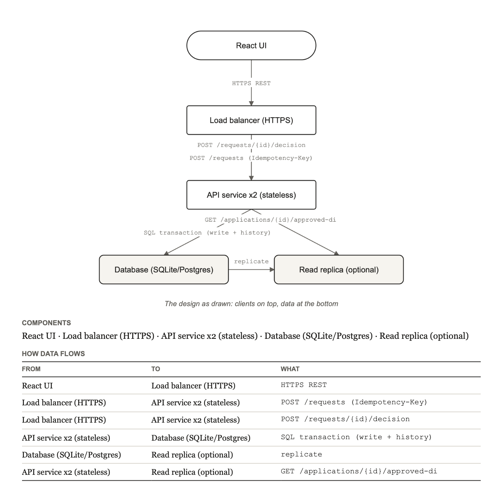

# AI usage

## Design before implementation

I drew the system design below before the implementation started. It
covers the deployment shape: a React UI, HTTPS load balancer, two
stateless API copies, database and an optional read replica, with
idempotent creation, a decision endpoint and a separate read of the
approved discount.



Claude Code built on that design and extended it. With some tweaks, I ended up
with the architecture of this system (can be found in [architecture.md](architecture.md)).
The diagram does not say how a request behaves inside the service, so the
implementation added that: immutable requests with linked revisions (D1), an
event log written in the same transaction as the state (D4), one open request
per application enforced by a partial unique index (D3), and an
approved-discount read limited to the mortgage process.

It also reduced the design where a smaller version proves the same
rules. So, the UI is plain HTML instead of React, the database is SQLite
instead of PostgreSQL, and there is one process with no load balancer or
read replica.

## How agents were used to build this

The code was written with Claude Code as an implementing agent, directed
step by step. The work followed this order:

1. The rules, stakeholder decision and the invariants, were written down first
  (`decisions.md`, `invariants.md`).
2. Each invariant became a named test before the code that satisfies it was
  accepted.
3. Implementation against the tests. The agent (and I) wrote the layers one
   at a time, starting from `domain.py` and working outwards.
4. Every change had to pass `ruff`, `mypy --strict`, the test suite and the
  invariant check. The UI was driven in a real browser, and `make demo` was run against a
   live server.

Things that I fixed/wrote myself or needed correcting along the way:

- The first demo script read a response header with the wrong letter
  case and failed. The fix is in `scripts/demo.py`.
- The first concurrency test used a lambda that `mypy --strict` rejected.
  It now uses `functools.partial`.
- A `python_version` pin in the mypy settings clashed with an installed
  type stub. The pin was removed, since the code targets 3.11 and up.
- Style rules such as for example 79-character lines were enforced by the linter,
  not by asking the agent to remember them.
- Coding tweaks and individual functions.
- Documentation.
- UI design (created a skeleton and redeveloped/documented with Claude Design
  Skill).

## Bonus: agents in the SDLC around this service

### Reason why

Use of AI agents in a pricing service can be risky (e.g., deleting or
weakening tests, putting writes outside transactions, etc.).
Normal code review can miss these when the diff is large.

### What is in the repository

| Piece | Role |
|---|---|
| `CLAUDE.md` | Instructions for coding agents. |
| `.claude/agents/invariant-reviewer.md` | Read-only AI reviewer that checks diffs against `invariants.md` and `decisions.md` |
| `scripts/check_invariants.py` | Deterministic gate that fails CI when an invariant test disappears or a new one is not registered|
| `.github/workflows/ci.yml` | Pipeline that runs lint, types, tests and the invariant check on every push |

Use of reviewer in Claude Code, ask: *"Use the invariant-reviewer
agent to review my changes against main."*

### Controling agent's output

The AI reviewer only advises. It has no write tools, and it has to name a
concrete sequence of calls before it may mark something as `block`.
Merging still needs a person/reviewer.

What actually blocks a merge is the test suite and the invariant check.
So an agent cannot move past them.

Example of the check catching a renamed test:

```
$ python scripts/check_invariants.py
✗ test_invariant_a_decided_request_is_final is listed in docs/invariants.md but does not exist
✗ test_invariant_renamed is an invariant test missing from docs/invariants.md
```

### Risks that remain

- A clean review from the agent does not mean te change is safe. The agent just
  didn't find anything.
- The gate protects listed invariants only.
- The check proves a test exists, not that it still asserts the right thing. I
  considered mutation testing could close part of that gap.
- Diffs sent to a hosted model may contain sensitive details. In a bank, this
  would need an approved mnodel endpoint and policies. 

### Ideas not built: out of scope (or would build wiht time)

- An assistant in the reviewer screen that summarises the request
  history and compares the discount with past approvals for similar
  cases. It would only advise. The reviewer keeps the decision, and the
  summary is stored with the decision for audit.
- An agent that turns a new line in `decisions.md` into a draft
  invariant test, for a person to review.
