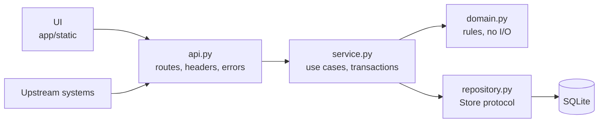
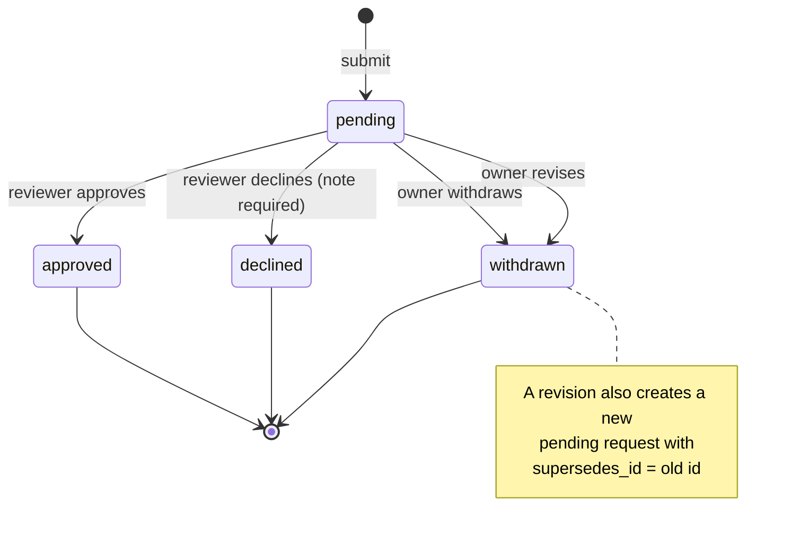
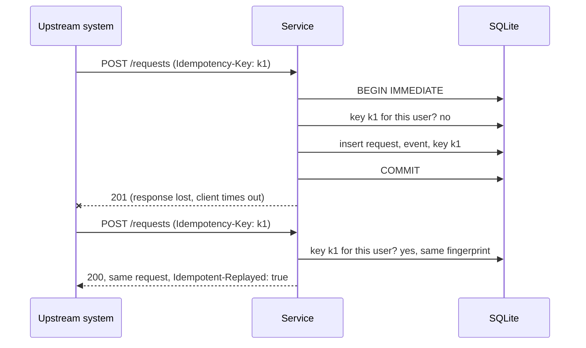
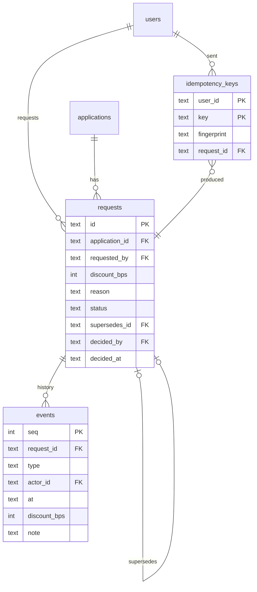

# Architecture and technical design

## Layers

Dependencies point one way. `domain.py` imports nothing from the rest of
the app, so every rule can be tested without a database.

| Module | Owns | Does not do |
|---|---|---|
| `domain.py` | States, transitions, validation, who may do what | Storage or HTTP |
| `service.py` | One transaction per use case, idempotency, cross-record checks, logging | SQL or status codes |
| `repository.py` | SQL, schema, row mapping, constraints | Business decisions |
| `api.py` + `schemas.py` | Routes, headers, JSON shapes, error mapping | Business rules |

Domain functions return a `Transition`: the new request plus the event
that records the change. The service saves both together, so
state and history can't disagree.

## Request lifecycle

`pending` and `approved` count as open. Only one open request per
application is allowed.

## Retry after a timeout

Because the key and the request are committed together, there is no
moment where one exists without the other. `BEGIN IMMEDIATE` makes
parallel retries wait their turn, so eight simultaneous calls still create
one request (see `test_concurrent_retries_create_exactly_one_request`).

## Data model

Other database rules:

- `one_open_request_per_application` is a partial unique index on
  `requests(application_id)` for open statuses. It backs up the service
  check under concurrency.
- `status` has a `CHECK` constraint with the allowed values.
- Foreign keys are on for every connection.
- Timestamps are ISO 8601 strings in UTC.

## Error mapping

| Error class | HTTP | When |
|---|---|---|
| `InvalidInputError` | 422 | Payload breaks a rule, or the idempotency key is missing or reused |
| `UnauthenticatedError` | 401 | Missing or unknown `X-User-Id` |
| `PermissionDeniedError` | 403 | Wrong role, or deciding your own request |
| `NotFoundError` | 404 | Unknown request or application |
| `ConflictError` | 409 | Request already decided, or the application already has an open request |

The domain and service raise these classes.

Only `api.py` knows about
status codes.
