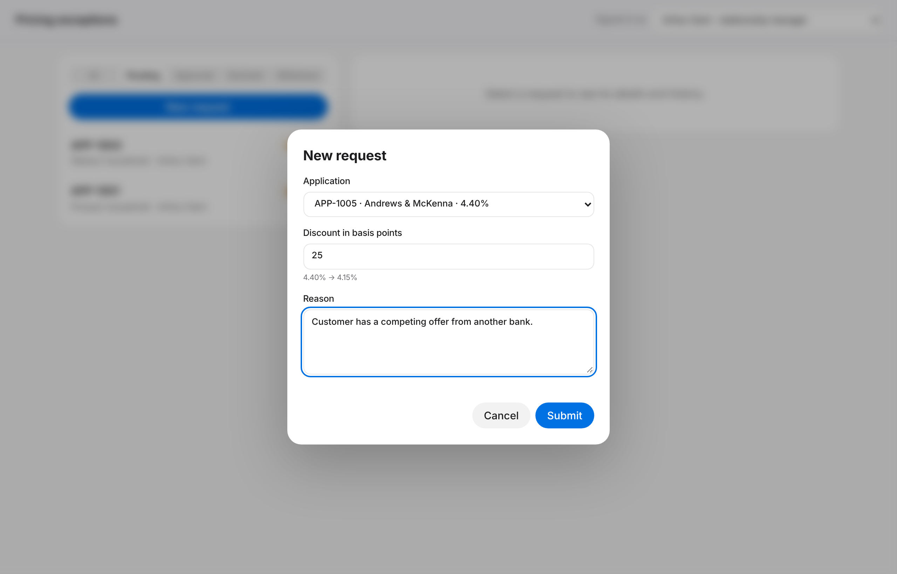
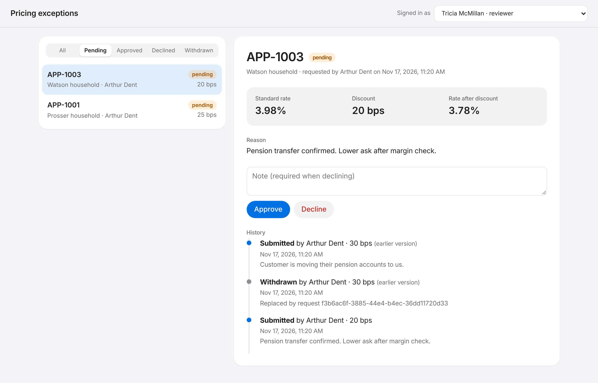

# User guide

How to use the pricing exception screen. Open <http://localhost:8000>
after `make run`.

## Signing in

Pick your name in **Signed in as** at the top right. This stands in for
real sign-in during the exercise. What you can do depends on your role.

| Person | Role |
|---|---|
| Arthur Dent, Ford Prefect | Relationship manager |
| Tricia McMillan, Fenchurch | Reviewer |
| Cindy Steward | Both roles |
| Mortgage process | System, API only |

## Finding a request

The list on the left shows requests, newest first. Use the filter above it
to show **All**, **Pending**, **Approved**, **Declined** or **Withdrawn**.
Click a request to see its details on the right: the rate before and
after the discount, the reason, the decision and the full history.

## For relationship managers

### Ask for a discount

1. Click **New request**.
2. Choose the application. Only applications without an open request are
   listed.
3. Enter the discount in basis points (25 bps = 0.25%). The line under
   the field shows the rate before and after.
4. Write a reason of at least 10 characters, then click **Submit**.



### Change the discount

Open your pending request and click **Change discount**. Your current
request is withdrawn and a new one goes to review. Both stay visible in
the history, marked as earlier versions. You cannot change a request once
it has been decided.

### Withdraw

Open your pending request and click **Withdraw**. The application is then
free for a new request.

## For reviewers

1. Filter on **Pending** and open a request.
2. Check the reason, the rates and the history.
3. Click **Approve**, or write a note and click **Decline**. A note is
   required to decline.
4. The request moves to Approved or Declined, with your name and the
   time.

You will not see approve buttons on your own requests. A decision is
final, so it cannot be changed by you or another reviewer.



## Messages you may see

| Message | Meaning |
|---|---|
| Add a note explaining why the request is declined | Write a note before declining |
| Request is already *status* | Someone acted first. The screen refreshes with the current state. |
| Discount must be between 1 and 100 basis points | The amount is outside policy |
| This application already has an open request | Wait for the current request to be decided or withdrawn |

## For the mortgage application process

Systems call the API rather than the screen:

```
GET /api/applications/{id}/approved-discount
X-User-Id: mortgage-engine
```

This returns the approved discount and the final rate, or `404` when no
discount is approved. Any other user receives `403`. The full API is described at
<http://localhost:8000/docs>.
